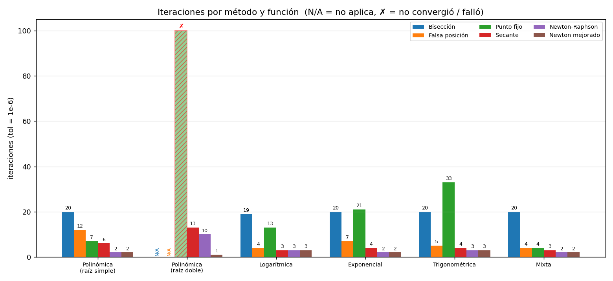
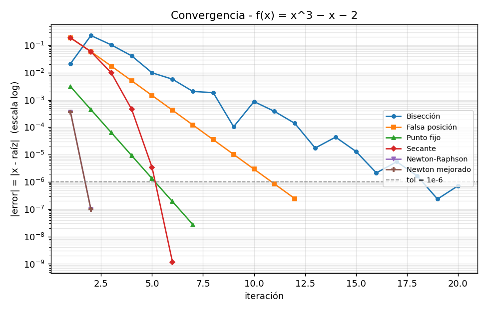
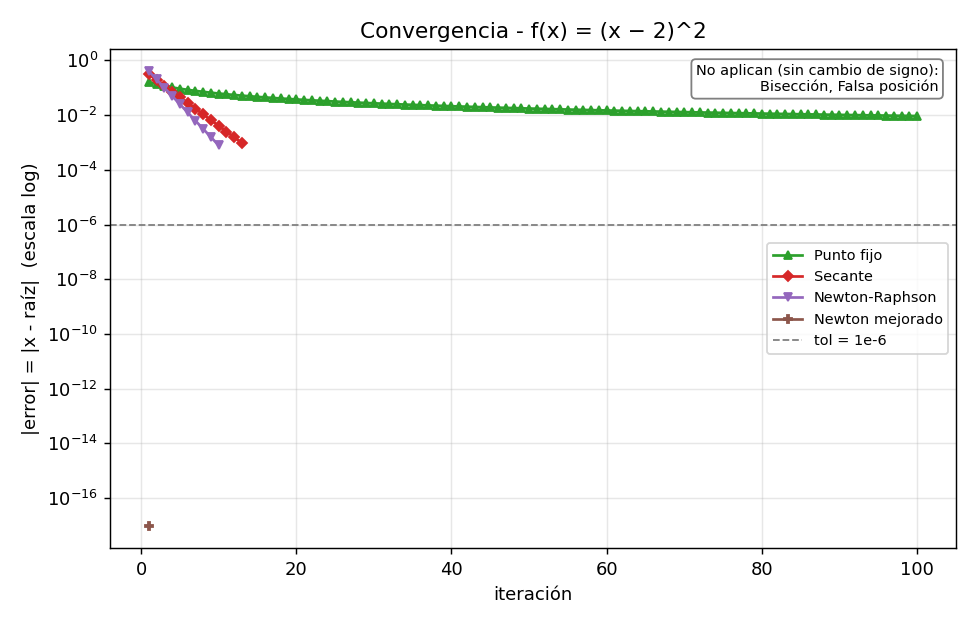
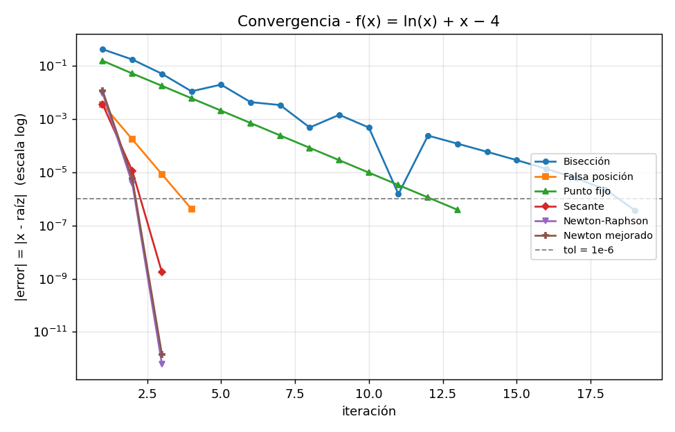
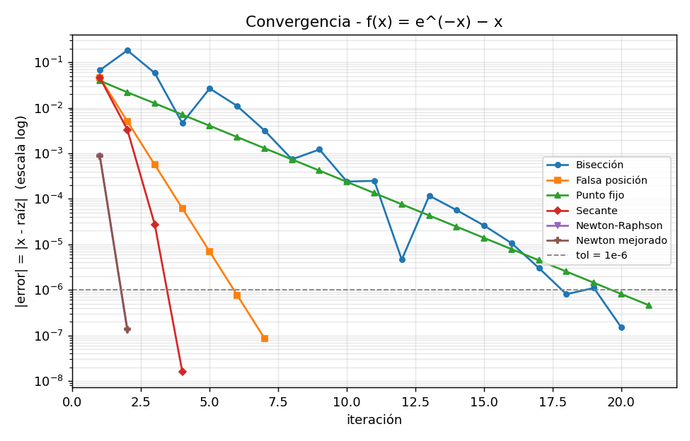
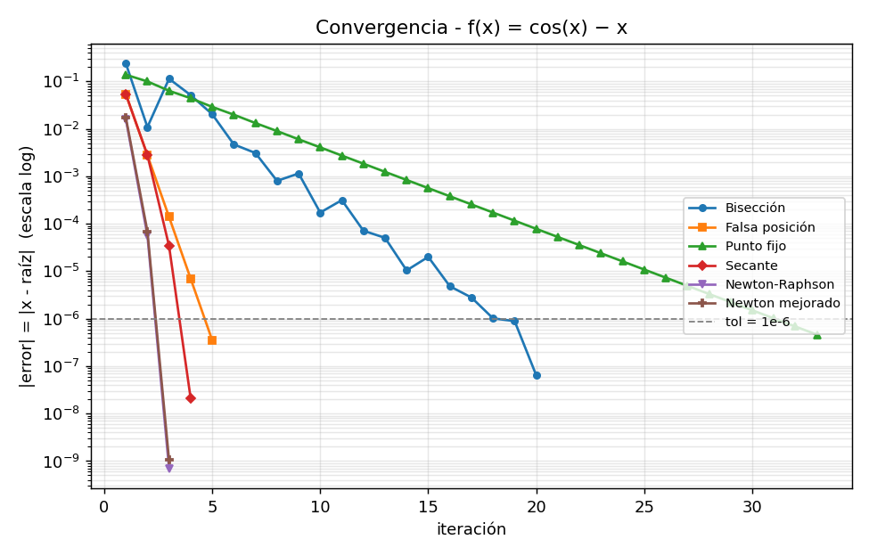
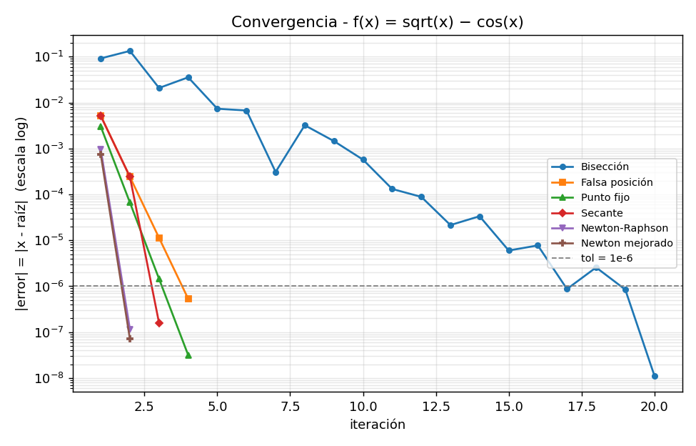

## 2. Resultados de convergencia

Cantidad de iteraciones requeridas para alcanzar la condición de término (donde N/A significa que el método no es aplicable y ✕ señala que no se logró converger tras 100 iteraciones):

| Función | Bisección | Falsa posición | Punto fijo | Secante | Newton | Newton mejorado |
|---|---|---|---|---|---|---|
| x³ − x − 2 | 20 | 12 | 7 | 6 | **2** | **2** |
| (x − 2)² (doble) | N/A | N/A | ✗ (100) | 13 | 10 | **1** |
| ln(x) + x − 4 | 19 | 4 | 13 | **3** | **3** | **3** |
| e^(−x) − x | 20 | 7 | 21 | 4 | **2** | **2** |
| cos(x) − x | 20 | 5 | 33 | 4 | **3** | **3** |
| √x − cos(x) | 20 | 4 | 4 | **3** | **2** | **2** |

En cuanto al error real final |x - raíz| (cuyo desglose completo se encuentra disponible en resumen_convergencia.csv), para las cinco funciones con raíz simple, la totalidad de los algoritmos que logran converger finalizan con valores ubicados entre ~1e-13 y ~7e-7. Estas variaciones no representan un mayor o menor grado de precisión entre los métodos, sino que obedecen únicamente a la iteración exacta en la que se satisface por primera vez la condición de parada |f| < 1e-6 o |paso| < 1e-6.

| | |
|---|---|
|  |  |
|  |  |
|  |  |

## 3. Preguntas de convergencia

### 3.1 ¿Qué método convergió en menos iteraciones en cada función? ¿Por qué?

El método de Newton mejorado obtiene el mejor rendimiento (o empata en el primer lugar) a lo largo de las seis funciones evaluadas, mientras que el método de Newton clásico lo iguala en las cinco funciones que poseen raíces simples. Específicamente, ambos requieren 2 iteraciones para las funciones polinómica simple, exponencial y mixta; 3 iteraciones tanto en la logarítmica como en la trigonométrica (empatando en el caso logarítmico con el método de la secante, que también toma 3 pasos); y apenas 1 iteración para la función con raíz doble (logrado exclusivamente por Newton mejorado). Muy de cerca se ubica el método de la secante, el cual demanda entre 3 y 6 iteraciones.

Este comportamiento se explica fundamentalmente por el orden de convergencia de cada algoritmo. Al emplear la derivada exacta, el método de Newton presenta una convergencia cuadrática, lo que implica que la cantidad de cifras significativas correctas se duplica en cada paso. Por su parte, la secante estima la derivada mediante dos puntos y alcanza un orden superlineal; mientras que los algoritmos de convergencia lineal (bisección, falsa posición y punto fijo) solo consiguen añadir una cantidad constante de dígitos precisos por iteración. No obstante, cabe señalar una consideración importante: en estas pruebas el valor inicial x₀ se encuentra próximo a la solución (en el punto medio del intervalo), condición que beneficia notablemente a Newton. Como se detallará en el apartado 3.5, al partir de valores iniciales x₀ distintos, esta ventaja disminuye o incluso desaparece por completo.

Al comparar únicamente los algoritmos de orden lineal, el método de falsa posición demostró ser el más veloz en tres de las cinco funciones simples (logarítmica, exponencial y trigonométrica) e igualó con el método de punto fijo en la función mixta (requiriendo 4 iteraciones cada uno); en cambio, en la polinómica simple el punto fijo resultó ganador (7 pasos frente a 12). En comparación con la bisección, la falsa posición empleó entre 4 y 12 iteraciones frente a las 19–20 del primero. Pese a ello, la bisección destaca por ser el método más predecible, manteniendo un rango constante de 19 a 20 iteraciones en todos los casos, dado que su desempeño depende exclusivamente de la amplitud del intervalo inicial.

### 3.2 ¿Qué orden de convergencia tiene cada método y cómo se refleja en |error| vs iteración?

Cálculo empírico obtenido mediante la función estimar_orden (correspondiente a la columna orden_estimado del archivo resumen_convergencia.csv):

| Método | Orden teórico | Orden estimado en los datos |
|---|---|---|
| Bisección | lineal (razón 1/2) | 1,00 (calculado con la semiamplitud del intervalo, que se divide a la mitad exactamente) |
| Falsa posición | lineal | 1,00 |
| Punto fijo | lineal | 1,00 |
| Secante | ≈ 1,618 | 1,52 – 1,69 en las funciones de raíz simple (1,61; 1,52; 1,69; 1,58); en la mixta dio 2,40, pero con solo 3 iteraciones el dato no es confiable |
| Newton | 2 | 2,00 (logarítmica y trigonométrica) |
| Newton mejorado | 2 | 2,00 y 2,01 (logarítmica y trigonométrica) |

En diversas funciones, el método de Newton alcanza la convergencia en apenas 2 o 3 iteraciones; al contar con una cantidad tan reducida de puntos, resulta imposible realizar una estimación del orden (por ello, la tabla únicamente reporta los casos donde existían datos suficientes).

Al observar la gráfica de |error| en función de las iteraciones utilizando una escala logarítmica en el eje vertical, los algoritmos de orden lineal se representan como una línea recta, dado que el error se reduce multiplicándose por un factor constante en cada etapa. La inclinación de dicha recta permite diferenciar al método de bisección (cuyo factor es 1/2) del método de punto fijo (con un factor dado por |g'(raíz)|, que toma un valor de ≈ 0,34 en el caso logarítmico, por ejemplo). Por otro lado, tanto la secante como Newton se visualizan como curvas que caen de manera acelerada: su pendiente se incrementa en cada paso, lo cual constituye el rasgo característico de un orden de convergencia superior a 1. Finalmente, cabe notar que en la bisección el valor de |x_k - raíz| no disminuye de manera monótona —puesto que la aproximación del punto medio puede ubicarse circunstancialmente más cerca o más lejos de la solución exacta—, provocando que su curva presente una apariencia dentada a pesar de que la cota máxima del error se reduzca exactamente a la mitad en cada iteración.

### 3.4 Raíz doble f(x) = (x − 2)²

| Método | Resultado |
|---|---|
| Bisección | No aplica (no hay cambio de signo) |
| Falsa posición | No aplica |
| Punto fijo (`g = x + (x−2)²`) | No converge en 100 iteraciones; error final 9,2e-3. Como g′(2) = 1, la convergencia es sublineal (el error decrece aproximadamente como 1/n) |
| Secante | 13 iteraciones, error real 9,6e-4, orden ≈ 1 |
| Newton | 10 iteraciones, error real 7,8e-4, orden ≈ 1 (el error se divide por 2 en cada paso) |
| Newton mejorado | 1 iteración, x = 2 exacto, error 0 |

El desempeño más destacado corresponde a Newton mejorado. En presencia de una raíz doble, el método de Newton clásico pierde su convergencia cuadrática debido a que f'(x*) = 0, degradándose a un comportamiento lineal con una razón de 1/2. Por el contrario, la variante mejorada aplica la expresión x - f·f' / (f'² - f·f''), la cual, al evaluarse en (x - 2)², se simplifica directamente a x - (x - 2), alcanzando la solución exacta en un único paso. Cabe aclarar que este resultado tan inmediato responde a un escenario particularmente ventajoso (al tratarse de un polinomio de segundo grado) y no debe generalizarse asumiendo que resolverá cualquier raíz múltiple en una sola iteración; no obstante, la propiedad que sí se conserva en general es la recuperación del orden cuadrático.

Asimismo, resulta importante señalar una particularidad respecto a la condición de término. Tanto el método de la secante como el de Newton dieron por finalizada su ejecución al cumplirse que |f| = (x - 2)² < 1e-6; sin embargo, esto sucede apenas |x - 2| < 1e-3, provocando que ambos algoritmos se detengan con un error cercano a 1e-3 en lugar de 1e-6. Esto demuestra que, al trabajar con una raíz doble, obtener un residuo pequeño puede resultar engañoso respecto a cuán próximo se está realmente de la solución. Por este motivo, el presente análisis evalúa el error real frente a la raíz exacta y no únicamente el valor de |f(x)|.
