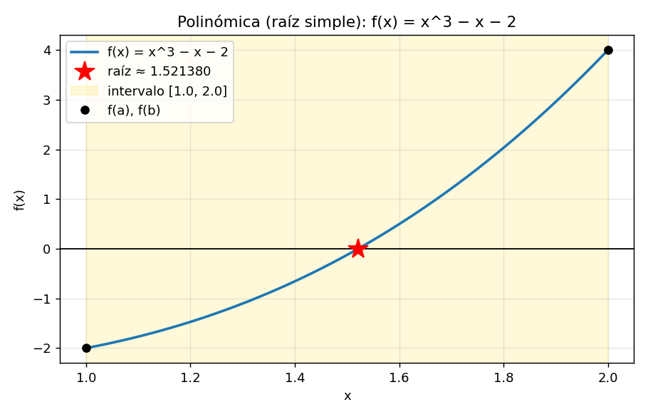
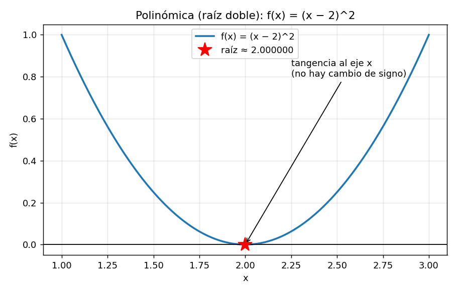
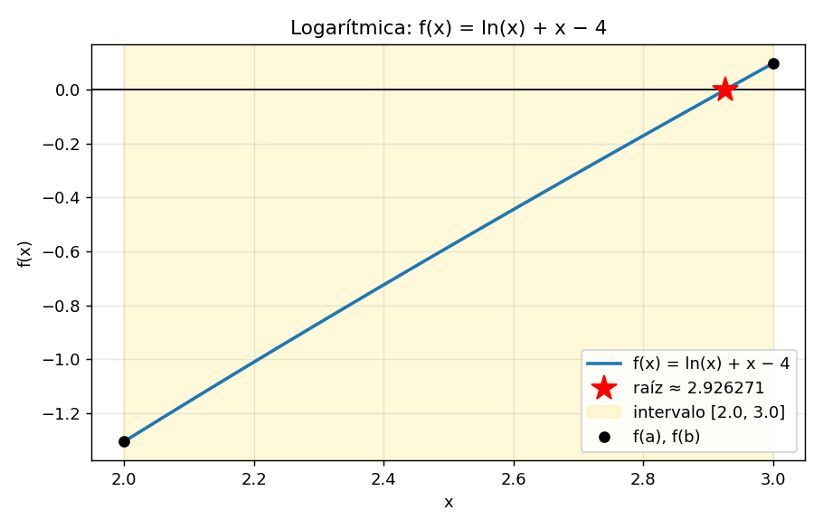
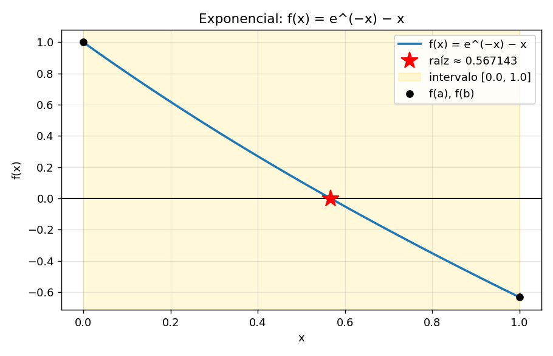
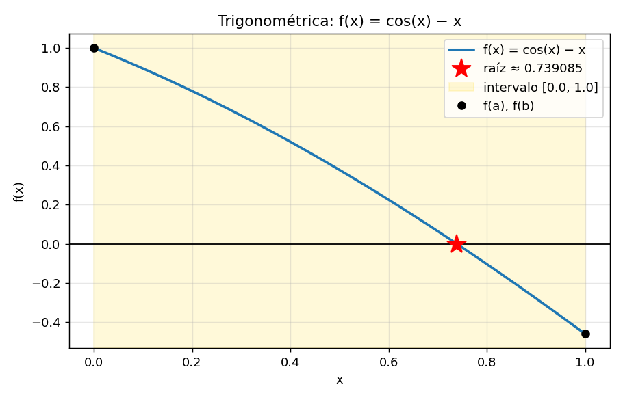
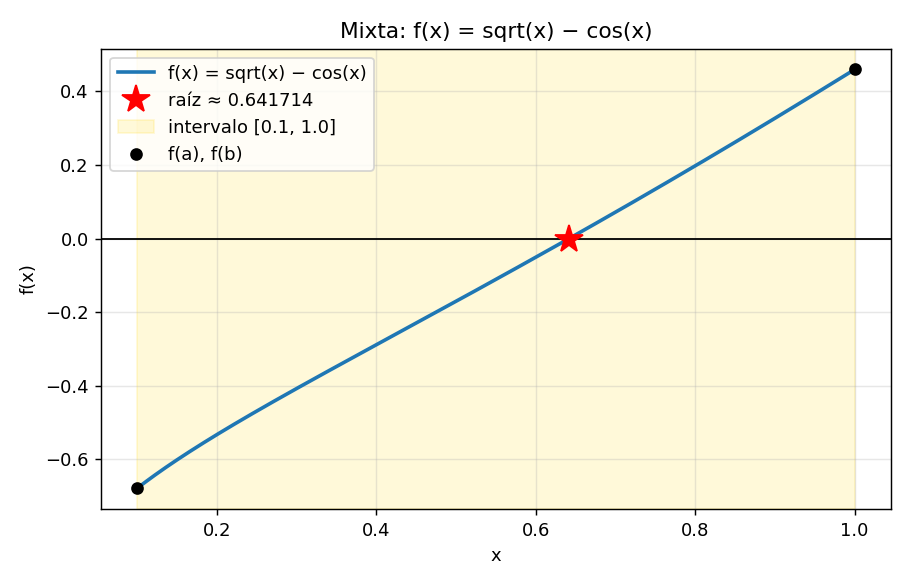
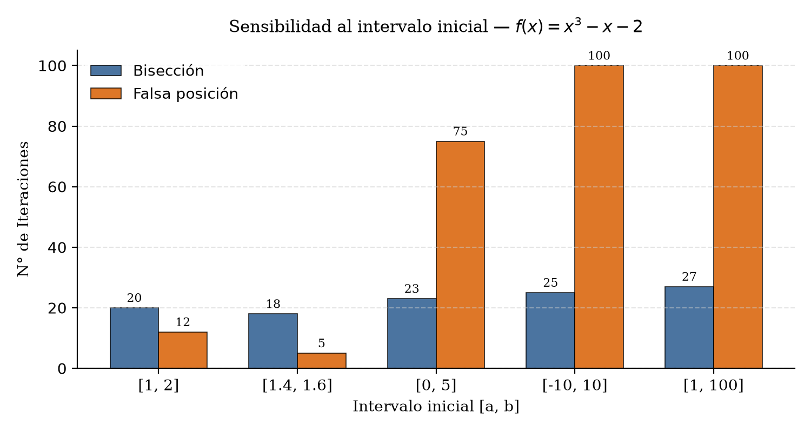
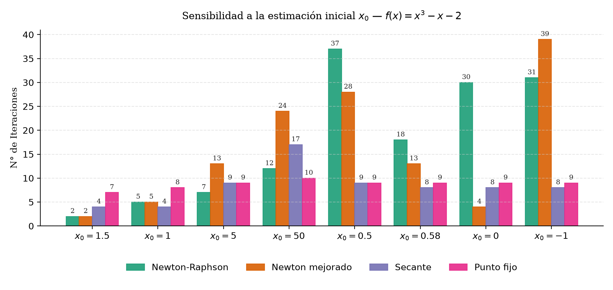

# Informe — La raíz que se esconde

**Comparación de métodos de búsqueda de raíces y su convergencia**

Universidad Católica del Maule · Laboratorio evaluado 2

**Integrantes:** *Nicolás Aburto I. & Francisco Cartes V.*

Los datos y gráficos se generaron mediante los scripts `src/scripts/generar_todo.py` y `src/scripts/sensibilidad.py`, el cual se explica en el archivo `README.md`. Para las pruebas se utilizó una tolerancia de `1e-6`, con un máximo de 100 iteraciones. Se consideró que un método había alcanzado la convergencia cuando se cumplía uno de estos criterios: `|f(x)| < tol` o `|x − x_anterior| < tol`.

## 1. Ambiente controlado

Para comparar el comportamiento, se trabajó con seis funciones distintas: polinómicas, logarítmicas, exponenciales, trigonométricas y mixtas. Cada una se evaluó utilizando los intervalos y las estimaciones iniciales indicadas en la siguiente tabla.

| Categoría | Función | [a, b] | x₀ (PF / Newton) | x₀, x₁ (secante) | f(a)·f(b) | Demostración de la raíz |
|---|---|---|---|---|---|---|
| Polinómica (simple) | x³ − x − 2 | [1, 2] | 1,5 | 1; 2 | −8 | Bolzano: cambio de signo |
| Polinómica (doble) | (x − 2)² | [1, 3] | 1,2 | 1,2; 1,5 | +1 | Tangencia: f(2) = 0 y f′(2) = 0, f ≥ 0 |
| Logarítmica | ln(x) + x − 4 | [2, 3] | 2,5 | 2; 3 | −0,129 | Bolzano |
| Exponencial | e^(−x) − x | [0, 1] | 0,5 | 0; 1 | −0,632 | Bolzano |
| Trigonométrica | cos(x) − x | [0, 1] | 0,5 | 0; 1 | −0,460 | Bolzano |
| Mixta | √x − cos(x) | [0,1; 1] | 0,55 | 0,1; 1 | −0,312 | Bolzano |

Para el método de punto fijo se utilizaron las siguientes expresiones de \(g(x)\), adaptadas a cada función:

- Polinómica simple: `g = (x+2)^(1/3)`.
- Polinómica doble: `g = x + (x−2)²`.
- Logarítmica: `g = 4 − ln x`.
- Exponencial: `g = e^(−x)`.
- Trigonométrica: `g = cos x`.
- Mixta: `g = x − 0,8(√x − cos x)`.

Para la función mixta, la expresión directa `g = cos²x` no resultó conveniente, porque el valor de \(|g′|\) cerca de la raíz es aproximadamente 0,96. Entonces la convergencia sea bastante lenta y que se necesiten alrededor de 270 iteraciones. Para evitar este problema, se utilizó una versión relajada de la función.

Los datos completos de esta sección se encuentran en `src/data/ambiente_controlado.csv`.

A continuación, se presentan los gráficos de las seis funciones, en los que se marca la ubicación de sus respectivas raíces.

| | | |
|---|---|---|
|  |  |  |
|  |  |  |

## 2. Resultados de convergencia

Cantidad de iteraciones requeridas para alcanzar la condición de término (donde N/A significa que el método no es aplicable y ✕ señala que no se logró converger tras 100 iteraciones):

| Función | Bisección | Falsa posición | Punto fijo | Secante | Newton | Newton mejorado |
|---|---|---|---|---|---|---|
| x³ − x − 2 | 20 | 12 | 7 | 6 | **2** | **2** |
| (x − 2)² (doble) | N/A | N/A | ✗ (100) | 13 | 10 | **1** |
| ln(x) + x − 4 | 19 | 4 | 13 | **3** | **3** | **3** |
| e^(−x) − x | 20 | 7 | 21 | 4 | **2** | **2** |
| cos(x) − x | 20 | 5 | 33 | 4 | **3** | **3** |
| √x − cos(x) | 20 | 4 | 4 | **3** | **2** | **2** |

En cuanto al error real final |x - raíz| (cuyo desglose completo se encuentra disponible en resumen_convergencia.csv), para las cinco funciones con raíz simple, la totalidad de los algoritmos que logran converger finalizan con valores ubicados entre ~1e-13 y ~7e-7. Estas variaciones no representan un mayor o menor grado de precisión entre los métodos, sino que obedecen únicamente a la iteración exacta en la que se satisface por primera vez la condición de parada |f| < 1e-6 o |paso| < 1e-6.

| | |
|---|---|
|  |  |
|  |  |
|  |  |

## 3. Preguntas de convergencia

### 3.1 ¿Qué método convergió en menos iteraciones en cada función? ¿Por qué?

El método de Newton mejorado obtiene el mejor rendimiento (o empata en el primer lugar) a lo largo de las seis funciones evaluadas, mientras que el método de Newton clásico lo iguala en las cinco funciones que poseen raíces simples. Específicamente, ambos requieren 2 iteraciones para las funciones polinómica simple, exponencial y mixta; 3 iteraciones tanto en la logarítmica como en la trigonométrica (empatando en el caso logarítmico con el método de la secante, que también toma 3 pasos); y apenas 1 iteración para la función con raíz doble (logrado exclusivamente por Newton mejorado). Muy de cerca se ubica el método de la secante, el cual demanda entre 3 y 6 iteraciones.

Este comportamiento se explica fundamentalmente por el orden de convergencia de cada algoritmo. Al emplear la derivada exacta, el método de Newton presenta una convergencia cuadrática, lo que implica que la cantidad de cifras significativas correctas se duplica en cada paso. Por su parte, la secante estima la derivada mediante dos puntos y alcanza un orden superlineal; mientras que los algoritmos de convergencia lineal (bisección, falsa posición y punto fijo) solo consiguen añadir una cantidad constante de dígitos precisos por iteración. No obstante, cabe señalar una consideración importante: en estas pruebas el valor inicial x₀ se encuentra próximo a la solución (en el punto medio del intervalo), condición que beneficia notablemente a Newton. Como se detallará en el apartado 3.5, al partir de valores iniciales x₀ distintos, esta ventaja disminuye o incluso desaparece por completo.

Al comparar únicamente los algoritmos de orden lineal, el método de falsa posición demostró ser el más veloz en tres de las cinco funciones simples (logarítmica, exponencial y trigonométrica) e igualó con el método de punto fijo en la función mixta (requiriendo 4 iteraciones cada uno); en cambio, en la polinómica simple el punto fijo resultó ganador (7 pasos frente a 12). En comparación con la bisección, la falsa posición empleó entre 4 y 12 iteraciones frente a las 19–20 del primero. Pese a ello, la bisección destaca por ser el método más predecible, manteniendo un rango constante de 19 a 20 iteraciones en todos los casos, dado que su desempeño depende exclusivamente de la amplitud del intervalo inicial.

### 3.2 ¿Qué orden de convergencia tiene cada método y cómo se refleja en |error| vs iteración?

Cálculo empírico obtenido mediante la función estimar_orden (correspondiente a la columna orden_estimado del archivo resumen_convergencia.csv):

| Método | Orden teórico | Orden estimado en los datos |
|---|---|---|
| Bisección | lineal (razón 1/2) | 1,00 (calculado con la semiamplitud del intervalo, que se divide a la mitad exactamente) |
| Falsa posición | lineal | 1,00 |
| Punto fijo | lineal | 1,00 |
| Secante | ≈ 1,618 | 1,52 – 1,69 en las funciones de raíz simple (1,61; 1,52; 1,69; 1,58); en la mixta dio 2,40, pero con solo 3 iteraciones el dato no es confiable |
| Newton | 2 | 2,00 (logarítmica y trigonométrica) |
| Newton mejorado | 2 | 2,00 y 2,01 (logarítmica y trigonométrica) |

En diversas funciones, el método de Newton alcanza la convergencia en apenas 2 o 3 iteraciones; al contar con una cantidad tan reducida de puntos, resulta imposible realizar una estimación del orden (por ello, la tabla únicamente reporta los casos donde existían datos suficientes).

Al observar la gráfica de |error| en función de las iteraciones utilizando una escala logarítmica en el eje vertical, los algoritmos de orden lineal se representan como una línea recta, dado que el error se reduce multiplicándose por un factor constante en cada etapa. La inclinación de dicha recta permite diferenciar al método de bisección (cuyo factor es 1/2) del método de punto fijo (con un factor dado por |g'(raíz)|, que toma un valor de ≈ 0,34 en el caso logarítmico, por ejemplo). Por otro lado, tanto la secante como Newton se visualizan como curvas que caen de manera acelerada: su pendiente se incrementa en cada paso, lo cual constituye el rasgo característico de un orden de convergencia superior a 1. Finalmente, cabe notar que en la bisección el valor de |x_k - raíz| no disminuye de manera monótona —puesto que la aproximación del punto medio puede ubicarse circunstancialmente más cerca o más lejos de la solución exacta—, provocando que su curva presente una apariencia dentada a pesar de que la cota máxima del error se reduzca exactamente a la mitad en cada iteración.

## 3.3 ¿Qué métodos requieren un intervalo con cambio de signo y cuáles no?

La diferencia está en la forma en que cada método busca la raíz. La bisección y la falsa posición necesitan un intervalo cuyos extremos tengan signos opuestos, es decir, que se cumpla `f(a)·f(b) < 0`. Esta condición permite aplicar el teorema de Bolzano para garantizar que existe al menos una raíz dentro del intervalo, siempre que la función sea continua.

Esto explica lo que ocurrió con la función de raíz doble, \((x-2)^2\). En el intervalo [1, 3], el producto de los valores de la función en los extremos es positivo: `f(1)·f(3) = +1`. Como la función toca el eje X en \(x=2\), pero no lo cruza, no existe un cambio de signo. Por este motivo, los métodos de bisección y falsa posición indicaron que no podían aplicarse y terminaron sin realizar iteraciones.

Los métodos abiertos, como punto fijo, secante, Newton y Newton mejorado, no necesitan que exista un cambio de signo en un intervalo inicial. En su lugar, parten de una o más estimaciones de la raíz. Sin embargo, esta flexibilidad tiene una desventaja: no garantizan la convergencia en todos los casos.

Su comportamiento depende de las características de la función y de los valores iniciales. Por ejemplo, el método de punto fijo necesita una función \(g\) adecuada, mientras que Newton depende de que la derivada no sea nula en los puntos relevantes. La secante también puede presentar problemas si las estimaciones iniciales no son apropiadas. Además, cualquier método debe respetar el dominio de la función durante las iteraciones.

### 3.4 Raíz doble f(x) = (x − 2)²

| Método | Resultado |
|---|---|
| Bisección | No aplica (no hay cambio de signo) |
| Falsa posición | No aplica |
| Punto fijo (`g = x + (x−2)²`) | No converge en 100 iteraciones; error final 9,2e-3. Como g′(2) = 1, la convergencia es sublineal (el error decrece aproximadamente como 1/n) |
| Secante | 13 iteraciones, error real 9,6e-4, orden ≈ 1 |
| Newton | 10 iteraciones, error real 7,8e-4, orden ≈ 1 (el error se divide por 2 en cada paso) |
| Newton mejorado | 1 iteración, x = 2 exacto, error 0 |

El desempeño más destacado corresponde a Newton mejorado. En presencia de una raíz doble, el método de Newton clásico pierde su convergencia cuadrática debido a que f'(x*) = 0, degradándose a un comportamiento lineal con una razón de 1/2. Por el contrario, la variante mejorada aplica la expresión x - f·f' / (f'² - f·f''), la cual, al evaluarse en (x - 2)², se simplifica directamente a x - (x - 2), alcanzando la solución exacta en un único paso. Cabe aclarar que este resultado tan inmediato responde a un escenario particularmente ventajoso (al tratarse de un polinomio de segundo grado) y no debe generalizarse asumiendo que resolverá cualquier raíz múltiple en una sola iteración; no obstante, la propiedad que sí se conserva en general es la recuperación del orden cuadrático.

Asimismo, resulta importante señalar una particularidad respecto a la condición de término. Tanto el método de la secante como el de Newton dieron por finalizada su ejecución al cumplirse que |f| = (x - 2)² < 1e-6; sin embargo, esto sucede apenas |x - 2| < 1e-3, provocando que ambos algoritmos se detengan con un error cercano a 1e-3 en lugar de 1e-6. Esto demuestra que, al trabajar con una raíz doble, obtener un residuo pequeño puede resultar engañoso respecto a cuán próximo se está realmente de la solución. Por este motivo, el presente análisis evalúa el error real frente a la raíz exacta y no únicamente el valor de |f(x)|.

## 3.5 ¿Cómo influyen el intervalo inicial y la estimación inicial?

Los resultados muestran que la elección de los valores iniciales puede afectar considerablemente la cantidad de iteraciones necesarias para encontrar una raíz. Este efecto no es igual para todos los métodos: algunos mantienen un comportamiento relativamente estable, mientras que otros pueden volverse mucho más lentos o incluso dejar de converger.

### Efecto del intervalo inicial

Para analizar esta influencia se utilizó la función \(f(x)=x^3-x-2\), modificando el intervalo inicial y registrando el número de iteraciones de la bisección y la falsa posición. Los resultados se encuentran en `src/data/sensibilidad.csv`.

| Intervalo | Bisección | Falsa posición |
|---|---:|---:|
| [1, 2] | 20 | 12 |
| [1,4; 1,6] | 18 | 5 |
| [0, 5] | 23 | 75 |
| [−10, 10] | 25 | ✗ (100) |
| [1, 100] | 27 | ✗ (100) |

La bisección presentó un comportamiento bastante predecible. Aunque se aumentó considerablemente el ancho del intervalo, el número de iteraciones solo pasó de 18 a 27. Esto se debe a que en cada paso el método divide el intervalo por la mitad, por lo que su costo crece de manera logarítmica respecto al ancho inicial: 

N ≈ log₂((b − a) / tol)

La falsa posición, en cambio, fue mucho más sensible al intervalo elegido. Con intervalos pequeños y adecuados, logró encontrar la raíz en pocas iteraciones. Sin embargo, cuando el intervalo era muy amplio o asimétrico, uno de los extremos podía permanecer prácticamente fijo durante varias iteraciones. Esto ralentizó considerablemente el proceso y, en los intervalos [−10, 10] y [1, 100], el método no alcanzó la convergencia dentro del límite de 100 iteraciones.

En consecuencia, la falsa posición puede ser más rápida que la bisección cuando se trabaja con un intervalo favorable, pero esa ventaja no se mantiene necesariamente cuando cambian las condiciones iniciales.

### Efecto de la estimación inicial

También se estudió cómo influye el valor inicial \(x_0\) en los métodos de Newton, Newton mejorado, secante y punto fijo. Para la secante se utilizó como segunda estimación \(x_1=x_0+0,5\).

| x₀ | Newton | Newton mejorado | Secante | Punto fijo |
|---:|---:|---:|---:|---:|
| 1,5 | 2 | 2 | 4 | 7 |
| 1 | 5 | 5 | 4 | 8 |
| 5 | 7 | 13 | 9 | 9 |
| 50 | 12 | 24 | 17 | 10 |
| 0,5 | 37 | 28 | 9 | 9 |
| 0,58 | 18 | 13 | 8 | 9 |
| 0 | 30 | 4 | 8 | 9 |
| −1 | 31 | 39 | 8 | 9 |

Uno de los resultados más llamativos fue el del método de Newton. Con \(x_0=1,5\), encontró la raíz en solo dos iteraciones, mientras que con \(x_0=0,5\) necesitó 37. Esta diferencia se explica, en parte, por el comportamiento de la derivada de la función:

\[
f'(x)=3x^2-1
\]

La derivada se anula aproximadamente en \(x=0,577\). Cuando la estimación inicial se encuentra cerca de ese punto, el denominador de la fórmula de Newton se vuelve muy pequeño, lo que puede provocar saltos grandes entre iteraciones. En efecto, al comenzar con \(x_0=0,5\), el método llegó a \(x_1=-9\), alejándose considerablemente de la raíz antes de recuperarse.

En el otro extremo, al utilizar \(x_0=50\), Newton necesitó 12 iteraciones. Aunque la estimación inicial estaba lejos de la raíz, el método logró acercarse progresivamente hasta entrar en una zona donde la convergencia fue más rápida.

El método de punto fijo presentó menos variaciones: necesitó entre 7 y 10 iteraciones en todos los casos probados para esta función. Esto se relaciona con la estabilidad de la expresión utilizada, `g = (x+2)^(1/3)`, que se comportó como una contracción en la región analizada.

Estos resultados permiten ver que Newton puede ser muy eficiente cuando se parte de una buena estimación, pero su rendimiento depende mucho más del punto inicial que el del punto fijo en este experimento.

La estimación inicial también puede determinar si un método converge o no. Algunos casos adicionales permiten observarlo con mayor claridad:

- **Función trigonométrica, `cos(x) − x`:** Newton necesitó 3 iteraciones con \(x_0=0,5\), 5 con \(x_0=3\) y 8 con \(x_0=100\). Sin embargo, al comenzar en \(x_0=10\), no convergió dentro de las 100 iteraciones y terminó cerca de \(x=64,9\), lejos de la raíz, que se encuentra aproximadamente en \(0,739\). Esto demuestra que partir de un valor lejano no implica necesariamente que el método falle, pero tampoco permite asegurar que convergerá.
- **Función logarítmica, `ln(x) + x − 4`:** Newton encontró la raíz en 3 iteraciones con \(x_0=2,5\), en 6 con \(x_0=0,01\) y en 5 con \(x_0=50\). En cambio, al utilizar \(x_0=-1\), el método falló inmediatamente porque el logaritmo natural no está definido para valores negativos.
- **Raíz doble:** con Newton se necesitaron entre 7 y 12 iteraciones para los valores iniciales \(x_0 = 1,2\), \(x_0 = 0\), \(x_0 = 1,9\) y \(x_0 = 5\)., manteniendo una convergencia lineal. Newton mejorado, por su parte, encontró la raíz en una iteración en todos esos casos.

## 3.6 ¿Qué método se recomienda según el tipo de función?

No existe un único método que sea el mejor en todas las situaciones. La elección depende de la información disponible sobre la función, la calidad de las estimaciones iniciales y la importancia de garantizar que el proceso converja.

| Situación | Recomendación | Fundamento en los resultados |
|---|---|---|
| Existe un intervalo con cambio de signo y se necesita un método robusto | **Bisección** | Convergió en todos los intervalos probados, con 18–27 iteraciones. Su comportamiento es predecible y no depende de la forma de la función para reducir el intervalo. |
| Se conoce un intervalo adecuado y la función es continua | **Falsa posición** | Necesitó entre 5 y 12 iteraciones con intervalos favorables, pero llegó a 75 iteraciones o no convergió con intervalos más amplios. |
| Se conoce la derivada y se dispone de una buena estimación inicial | **Newton** | Fue uno de los métodos más rápidos, con 2–3 iteraciones en varias funciones de raíz simple. Sin embargo, puede fallar con estimaciones poco adecuadas. |
| No se dispone de la derivada o calcularla resulta costoso | **Secante** | Encontró las raíces sin utilizar derivadas explícitas y necesitó entre 3 y 6 iteraciones en varias de las pruebas de raíz simple. Su convergencia también depende de las estimaciones iniciales. |
| La raíz es múltiple o se sospecha que \(f'(x^*)=0\) | **Newton mejorado** | Recuperó una convergencia más rápida en el caso de raíz doble, encontrándola en una iteración frente a las 10 de Newton y las 13 de la secante. |
| La ecuación puede expresarse como \(x=g(x)\), con \(|g'(x)|<1\) cerca de la raíz | **Punto fijo** | Fue estable para la función polinómica simple, con 7–10 iteraciones en las estimaciones probadas. No obstante, puede ser lento o no converger con una elección inadecuada de \(g\). |

Una alternativa práctica es combinar métodos para aprovechar las ventajas de cada uno. Por ejemplo, se pueden realizar algunas iteraciones de bisección para obtener un intervalo más reducido y después continuar con Newton o la secante. De esta forma, se puede mejorar la estimación inicial y reducir el número de iteraciones necesarias, sin depender completamente de una única técnica.

## 4. Conclusión

### Comparación general de los métodos

A partir de los experimentos realizados, se puede concluir que la eficiencia de los métodos de búsqueda de raíces depende tanto de la función estudiada como de las condiciones iniciales. En las funciones de raíz simple, Newton y Newton mejorado destacaron por su rapidez, con resultados de entre 2 y 3 iteraciones en varias de las pruebas. La secante también presentó un buen rendimiento, con entre 3 y 6 iteraciones en esos casos.

La bisección necesitó más iteraciones, pero mostró un comportamiento mucho más predecible. En las pruebas realizadas con la función polinómica simple, convergió incluso cuando se utilizaron intervalos muy amplios, como [−10, 10] y [1, 100]. Por el contrario, la falsa posición, aunque fue rápida con intervalos adecuados, tuvo dificultades cuando uno de sus extremos permaneció prácticamente fijo.

La sensibilidad de Newton a la estimación inicial también quedó clara: para la misma función, el número de iteraciones varió entre 2 y 37, y hubo casos en los que el método no convergió. Por ello, la rapidez de Newton representa una ventaja importante, pero es necesario seleccionar cuidadosamente el punto de partida.

En términos prácticos, la bisección resulta apropiada cuando se prioriza la robustez y se dispone de un intervalo con cambio de signo. Newton es una buena alternativa cuando se conoce la derivada y se tiene una estimación inicial adecuada. Si no se dispone de la derivada, la secante permite obtener buenos resultados sin calcularla explícitamente. Finalmente, cuando se trabaja con raíces múltiples, Newton mejorado puede ofrecer una ventaja considerable.

### La raíz doble: tener una raíz no significa cambiar de signo

El caso de la función \((x-2)^2\) permitió observar una diferencia importante entre la existencia de una raíz y la presencia de un cambio de signo. Aunque la función tiene una raíz en \(x=2\), sus valores nunca son negativos y, por lo tanto, no cruza el eje X. Esto explica por qué el teorema de Bolzano no permite detectar esta raíz mediante el intervalo [1, 3].

En este escenario, la bisección y la falsa posición no pudieron aplicarse con el intervalo elegido. Los métodos abiertos sí pudieron aproximarse a la raíz, pero su rendimiento fue diferente al observado en las funciones de raíz simple. El método de punto fijo no alcanzó la tolerancia dentro de las 100 iteraciones, mientras que Newton y la secante mostraron una convergencia lineal, necesitando aproximadamente 10 y 13 iteraciones, respectivamente.

Newton mejorado obtuvo el mejor resultado en este caso, ya que encontró la raíz en una iteración. Esto se debe a que incorpora información de la segunda derivada para compensar la pérdida de velocidad que experimenta Newton cuando la derivada se anula en la raíz.

Por lo tanto, el experimento confirma que el cambio de signo es una condición suficiente para garantizar la existencia de una raíz en un intervalo continuo, pero no es una condición necesaria.

### Influencia del intervalo y de la estimación inicial

Los resultados de sensibilidad mostraron que ampliar el intervalo inicial no afecta de la misma manera a todos los métodos. En la bisección, pasar de [1, 2] a [1, 100] aumentó el número de iteraciones de 20 a 27, una variación moderada considerando la diferencia entre ambos intervalos. En la falsa posición, en cambio, el intervalo amplio provocó una pérdida importante de eficiencia e incluso impidió alcanzar la convergencia dentro del límite establecido.

Algo similar ocurrió con las estimaciones iniciales de Newton. En la función \(x^3-x-2\), cambiar \(x_0\) modificó considerablemente el número de iteraciones, especialmente cuando el valor inicial estaba cerca de un punto donde la derivada era pequeña. La secante y el punto fijo presentaron variaciones más acotadas en las pruebas realizadas, aunque esto no significa que sean siempre más estables para cualquier función.

En definitiva, seleccionar adecuadamente el intervalo o la estimación inicial es una parte fundamental del proceso. No basta con elegir un método que sea rápido en teoría: también hay que considerar cómo se comporta frente a las características particulares de la función.

### Limitaciones del experimento

Finalmente, es importante considerar algunas limitaciones al interpretar los resultados. El número de iteraciones depende del criterio de parada utilizado, ya sea el valor de la función o la diferencia entre aproximaciones consecutivas. Por este motivo, al modificar dicho criterio, los conteos podrían variar en una o más iteraciones.

Además, los órdenes de convergencia estimados a partir de solo dos o tres iteraciones deben interpretarse con precaución, ya que pueden no representar el comportamiento asintótico real de los métodos. Por otra parte, cada función se evaluó con una configuración inicial de referencia y con las variaciones indicadas en la sección 3.5, por lo que no es posible generalizar todas las diferencias observadas a cualquier función.

A pesar de estas limitaciones, los resultados permiten comparar de forma práctica la velocidad, la estabilidad y las condiciones de aplicación de los métodos estudiados. La principal conclusión es que la elección de un método numérico debe considerar tanto su rapidez potencial como la información disponible sobre la función y las garantías de convergencia que se necesitan.